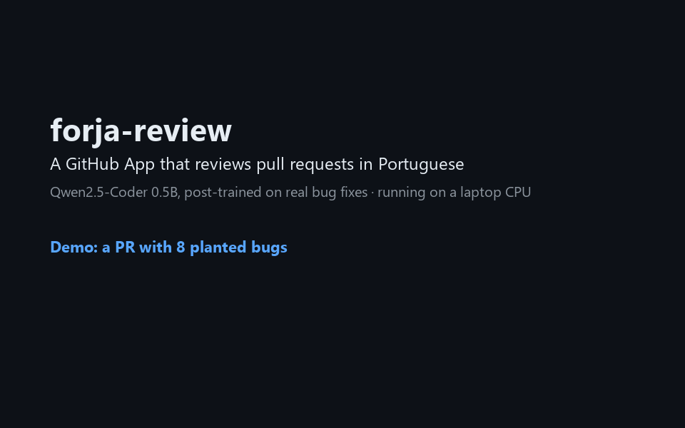

# forja-review

**The capstone of [Forja](../forja).** A GitHub App that reviews pull requests in Portuguese: it explains what changes and points out bugs on the diff's lines. It calls the model through [forja-serve](../forja-serve) (or any OpenAI-compatible endpoint) and sends OpenTelemetry traces that [forja-evals](../forja-evals) evaluates as an **online eval**.

> **Result:** the whole pipeline works: webhook → queue → model → comments anchored to lines → feedback → traces → online eval. **The small model did not, at first.** With Gemma 4 26B running locally as the ceiling, the review finds **4/4 bugs** on a held-out PR (7/8 on the tuning one). With Qwen2.5-Coder 0.5B (through forja-serve) and the 1.5B, it finds **0/4**. Instead of hiding that, it became the number post-training had to move. After training on real bug fixes ([forja-posttrain R2](../forja-posttrain)), the 0.5B finds 25–27 of 199 real bugs with 21–23% precision, and the mixed model finds 4/8 on the planted PR with no wrong comment.



The demo above is a real run: the mixed-data model (R2, D3) served by forja-serve on a laptop CPU reviews [josuekuhim/forja-review-demo#1](https://github.com/josuekuhim/forja-review-demo/pull/1) through the GitHub App (`forja-review pr`, no webhook), in 3 min 57 s. Of its 4 inline comments, 3 point at real planted bugs (pagination with `//`, `maior_venda` on an empty list, SQL injection) and 1 is a confused duplicate of the SQL injection one. It missed the other 5 bugs, including the unclosed file and the division by zero.

## Measuring before installing: PRs with planted bugs

Before putting a real user in front of it, the question is simple: **does it find real bugs?** To answer it, there are two sample PRs with planted bugs and an answer key:

- [`examples/pr-bugs-plantados.diff`](examples/pr-bugs-plantados.diff) has 8 bugs: SQL injection, an unclosed file and connection, 3 divisions by zero or by an empty list, an off-by-one and a `//` that loses the last page. It is the set used to **tune** the prompt.
- [`examples/pr-holdout.diff`](examples/pr-holdout.diff) has 4 bugs: an inverted TTL condition, a mutable default argument, `requests.get` without a timeout and without checking the status. It is **held out**: it was created before tuning the prompt and never used for that.

A bug counts as found when there is a comment on the file, within 2 lines, that **names the problem** (an answer-key keyword). Position alone is not enough, and that was the first lesson:

> In the first measurement, by position only, Qwen 1.5B "found" 4/8. Reading the comments, none pointed at a bug: they were a changelog ("Added the `percentual` function…"), and the pagination one recommended the opposite of the fix. With the content check, it dropped to 1/8.

| Model (CPU, Ryzen 5 5625U) | Prompt | Tuning (8 bugs) | **Held-out (4 bugs)** | Broken format | Time per PR |
| --- | --- | --- | --- | --- | --- |
| Qwen2.5-Coder 1.5B Q4_K_M (llama.cpp) | v0 | 1/8 | 0/4 | 1 of 5 calls | 30–40 s |
| Qwen2.5-Coder 1.5B Q4_K_M (llama.cpp) | v1 | 1/8 | 0/4 | 1 of 5 | 15–30 s |
| Qwen2.5-Coder 1.5B Q4_K_M + `json_mode` | v1 | 1/8 | 0/4 | 0 (grammar) | 15–30 s |
| Qwen2.5-Coder 0.5B fp32 (**forja-serve**) | v1 | 0/8¹ | 0/4 | 2 of 5, +1 cut at 512 tokens | 1–2 min |
| Gemma 4 26B-A4B Q4_0 (llama.cpp), ceiling | v1 | **7/8** | **4/4** | 0² | 12–22 min |
| Qwen2.5-Coder 0.5B + SFT LoRA (forja-posttrain R1) | short | 2/8 | 0/4 | 0 | ~40 s |
| Qwen2.5-Coder 0.5B + SFT + DPO (forja-posttrain R1) | short | 3/8 | 0/4 | 0 | ~45 s |
| Qwen2.5-Coder 0.5B + SFT on mixed data (forja-posttrain R2, D3) | short | **4/8** (0 wrong) | 0/4 | 0 | ~30 s |
| `ruff` (no model, [`examples/linters.py`](examples/linters.py)) | — | 2/8 | 2/4 | — | 0.1 s |

¹ The keyword checker marked 1/8, but the comment says `media` "returns 0.0 if the list is empty", and it actually raises `ZeroDivisionError`. Counted as 0.
² On the first attempt, one Gemma call was cut: it spent all 4096 tokens reasoning before the JSON. With 8192, it found the inverted TTL condition, the subtlest bug. That now shows up in the trace as `resposta_cortada` (truncated answer), not as `json_invalido` (invalid JSON).

What the numbers say:

- **The pipeline is not the bottleneck.** The same prompt, the same anchoring and the same parser, with a capable model, find 11 of 12 bugs with zero extra comments, and each comment includes the fix (`with open(...)`, `?` in the query, `descontos=None`, `raise_for_status()`). Full results are in [`results/`](results).
- **The small base model does not find bugs: it describes the change.** The v1 prompt (checklist, solved example, explicit ban on describing) and the descriptive-comment filter removed the changelog. The real problem remained: the 1.5B and the 0.5B invent defects ("it should return two decimal places") or say the opposite of what is right. `json_mode` fixes the format, not the reasoning.
- **The ceiling's cost is time.** Gemma reasons for 1,500 to 4,500 tokens per file at ~7 tok/s: 12 to 22 min per PR on CPU. That works for a personal repository with few PRs; for real use, it needs a GPU or a small model that gets it right.
- **The bridge to the rest of Forja:** these two PRs become `deteccao_bug` cases in forja-evals, and the teacher-model approach (a large model writing answers that are checked against a known answer) became the recipe for forja-dados' real training data.

### After post-training: model + linter

[forja-posttrain](../forja-posttrain) trained the 0.5B with a LoRA and measured it on two PRs: a synthetic one with 60 files from templates never seen in training (53 bugs), and a real one with 199 bugs from 2025–2026 bug-fix commits plus 199 already-fixed files.

| Reviewer | Synthetic PR: bugs found (53) | Extras | Real PR: bugs found (199) | Real PR: wrong comments |
| --- | --- | --- | --- | --- |
| Qwen 0.5B base (short prompt) | 1 | 39 | 4 | 151 |
| Qwen 0.5B + SFT, synthetic data (R1) | 15 | 44 | 9 | 308 |
| Qwen 0.5B + SFT + DPO (R1) | 11 | 34 | — | — |
| **Qwen 0.5B + SFT, real data (R2, D2)** | 4 | 19 | **27** | **89** |
| Qwen 0.5B + SFT, mixed data (R2, D3) | 9 | 43 | 25 | 94 |
| ruff (bug/security rules) | **25** | **4** | 1 | 11 |
| **ruff + SFT (R1)** | **32** | 48 | — | — |

On the synthetic PR, the linter catches the pattern classes (string-built SQL, `shell=True`, mutable default, `requests` without a timeout) with almost no noise, and the model finds what the linter cannot see: inverted condition, division by an empty list, pagination. On real bugs, the linter finds almost nothing (1/199), and only the model trained on real fixes moves the number. The architecture these numbers suggest is **linter first, model for semantics**, with a model trained on real data. On-policy DPO on synthetic data tried to fix precision and only made the model quieter (details in [forja-posttrain](../forja-posttrain#on-policy-dpo)).

[`examples/linters.py`](examples/linters.py) runs ruff or bandit on the same diff, in the same `--json-out` format, so `recall.py`'s yardstick applies to both.

### The closed loop: online eval

The traces from these tests went through `forja-evals online` with Gemma as the judge: 12 sampled calls, mean score 1.43 for the 1.5B and 1.00 for the 0.5B. Of the small models' 14 comments, the judge marked **one** as useful, which is exactly the only real hit according to the answer key. See [`forja-evals/baselines/online-forja-review-local`](../forja-evals/baselines/online-forja-review-local).

## What is inside

| Piece | File | Tested guarantee |
| --- | --- | --- |
| Webhook with HMAC-SHA256 signature, triage (draft, bot, actions) | `app.py` | wrong signature → 401; the same commit is never queued twice |
| Durable SQLite queue (idempotent on `repo, pr, sha`, retry with backoff, crash recovery) | `store.py` | model down → back to the queue, gives up after 3 attempts; an orphaned `rodando` (running) job comes back on restart |
| GitHub App: RS256 JWT → installation token (cached) | `github.py` | JWT claims verified with the public key; the token is requested only once |
| Diff parser (API patch and `git diff`) with each line's new line number | `diff.py` | numbering, renamed, binary, deleted, "No newline" |
| Per-file prompt, split into whole hunks when it does not fit | `prompt.py` | nothing lost and numbering preserved when splitting |
| Anchoring: tolerant JSON, comments on lines outside the diff dropped, duplicates, excess, **descriptive comments** | `parse.py` | each drop becomes a `problema` (problem) in the trace, instead of an error |
| Review published with inline comments and a fallback to the body if GitHub refuses (422) | `worker.py` | old commit (a new push arrived) → ignored; 422 → everything in the body |
| Feedback: 👍/👎 per comment (reactions do not trigger a webhook; `feedback` fetches them) | `worker.py` | bot reactions do not count; no change means no re-emit |
| OpenTelemetry traces (JSONL and, optionally, OTLP) | `telemetry.py` | feedback points to the review's trace |

38 tests, no network: fake GitHub and model via `httpx.MockTransport`.

## How it works

```text
GitHub ──webhook──▶ POST /webhook ──▶ check HMAC ──▶ queue (SQLite, unique per commit) ──▶ 202
                                                           │
                         worker (same process) ◀───────────┘
                           1. installation token (JWT → /access_tokens, cached)
                           2. is the PR still at this commit? if not, skip
                           3. /pulls/{n}/files → each file's patch
                           4. per file: prompt with line numbers → model (forja-serve) → JSON
                           5. anchor (drop what is not in the diff) → POST /reviews (inline)
                           6. one forja.review.llm span per call → traces/spans.jsonl
forja-review pr owner/repo N ──▶ same queue, no webhook (installation found with the App's JWT)
cron: forja-review feedback ──▶ reads 👍/👎 → forja.review.feedback span
forja-evals online ──▶ sample of spans → per-comment judge → judge × humans
```

Decisions:

- **The review never runs inside the request.** GitHub waits at most 10 s for the webhook and redelivers on error; reviewing a PR takes from tens of seconds to minutes with a model on CPU. The endpoint only validates and enqueues.
- **SQLite instead of Redis.** The volume is a few PRs per hour. SQLite in WAL mode has the guarantees that matter (idempotency, persistence, atomic `UPDATE … RETURNING` to claim the job) without another service to operate.
- **One file per call.** Small context, simple anchoring (the model only sees that file's line numbers) and isolated failure: a broken JSON loses one file, not the review.
- **Comment only on lines that are in the diff.** The API rejects the whole review (422) if a line is not in a hunk. Anchoring drops them first; if the diff changes between reading and publishing, the fallback publishes everything in the body.
- **Privacy.** By default, the diff and the answer go into the trace, because the online eval needs them. In a private repository, `FORJA_REVIEW_CAPTURAR_CONTEUDO=0` keeps only the structured result.

## Usage

```bash
uv sync
uv run pytest

# Review a local diff (no GitHub), against forja-serve or llama.cpp
uv run forja-review local main...HEAD --repo-dir ../some-repo
uv run forja-review local --diff examples/pr-holdout.diff --base-url http://127.0.0.1:8001/v1 --json-out r.json
uv run python examples/recall.py examples/gabarito-holdout.json r.json

# Post-trained model: short prompt (the same as in training) and several files in parallel
FORJA_REVIEW_CONCORRENCIA=8 uv run forja-review local --diff examples/pr-holdout.diff --model review-sft --prompt curto --json-out r.json

# Non-model baseline, on the same yardstick
uv run python examples/linters.py examples/pr-holdout.diff --ferramenta ruff --json-out ruff.json

# As a GitHub App (see github-app.yml and .env.example)
uv run forja-review serve --port 8080      # webhook + worker
uv run forja-review pr owner/repo 1        # review one PR on demand, no webhook or tunnel needed
uv run forja-review feedback               # in a cron: collects 👍/👎
uv run forja-review stats                  # X PRs reviewed, Y% of comments useful
```

To install: create the App with the permissions in [`github-app.yml`](github-app.yml) (Pull requests: read & write, Contents: read), point the webhook at `/webhook` (a tunnel such as `cloudflared` works for running it at home; without a webhook, `forja-review pr` reviews on demand), keep the `.pem` key outside the repository and fill in `.env`.

## Limitations (honest ones)

- **No real users yet.** The App is ready to install, but the numbers above come from planted-bug PRs and a real-bug evaluation PR, not from traffic. The plan's "X PRs reviewed, Y% useful" only exists after installing it on real repositories; `stats` and `forja-evals online` already measure it.
- **12 planted bugs are not a benchmark.** They separate "finds" from "does not find" (0/4 vs. 4/4), not fine differences. The keyword checker is lenient (there was one false positive, counted by hand); the real yardstick is the online-eval judge, calibrated against 👍/👎, and the 199-bug real PR in forja-evals.
- **One review per commit.** A new push creates a new review; there is no incremental summary and no resolution of old comments.
- **Diff-only context.** The model sees neither the rest of the file nor the repository: a bug that depends on code outside the hunk gets through.
- **One process.** Webhook and worker in the same process; to scale, the worker becomes a separate process reading the same queue (`claim` is already atomic).
- **The ceiling is slow.** The model that works best (Gemma 26B) takes minutes per file on CPU.
